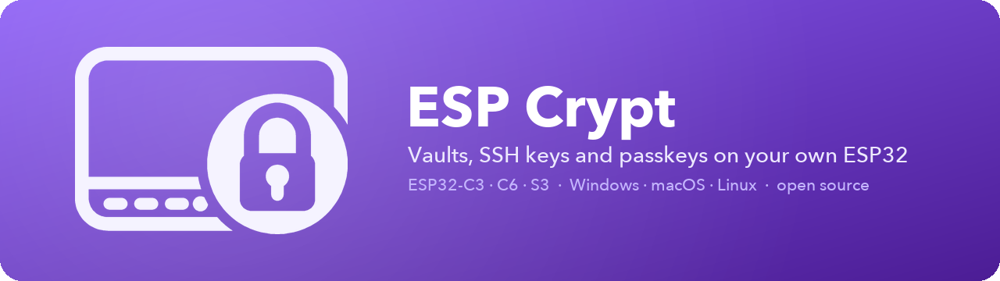
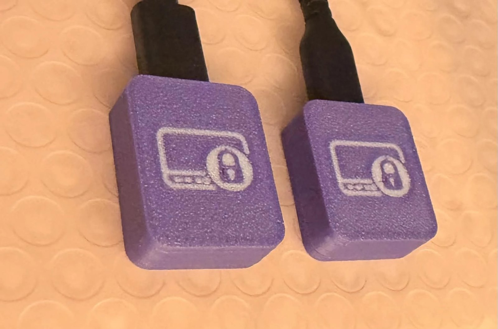

<p align="center">
  
</p>

# ESP Crypt

ESP Crypt turns a cheap ESP32 board into a hardware key for your computer:
encrypted VeraCrypt vaults, SSH keys and passkeys, protected by your passphrase.
The app installs the firmware on the board for you and keeps itself up to date.

<p align="center">
  
</p>

## Download

Get the latest version for Windows or macOS from
[Releases](https://github.com/espcrypt/manager/releases/latest).

Command line only (macOS or Linux):

```bash
curl -fsSL https://raw.githubusercontent.com/espcrypt/manager/main/scripts/install-macos.sh | bash
```

```bash
curl -fsSL https://raw.githubusercontent.com/espcrypt/manager/main/scripts/install-linux.sh | bash
```

For encrypted vaults, also install [VeraCrypt](https://veracrypt.io).

## What it does

- **Vaults:** VeraCrypt containers that only open while your board is plugged
  in and unlocked. Unplug the board and they lock.
- **SSH keys:** made on the board and used for ssh, git and VS Code Remote. The
  private key never leaves the board.
- **Passkeys:** an ESP32-S3 also works as a security key for passkeys and
  two-factor login.
- **Backup board:** keep a second board as a mirror, over USB or Wi-Fi, so
  losing one board loses nothing.
- **Command line:** `espcrypt status`, `unlock`, `open`, `close`, `sync` and
  more.

## Supported boards

| Board | Vaults and SSH | Passkeys |
| --- | --- | --- |
| Waveshare ESP32-S3-Zero | ✓ | ✓ |
| Seeed XIAO ESP32-S3 | ✓ | ✓ |
| ESP32-C3 SuperMini | ✓ | – |
| ESP32-C6 SuperMini | ✓ | – |

## Getting started

1. Install and open ESP Crypt.
2. Plug in a board and open the **ESP32** page.
3. Pick a firmware (Vault, Passkey, or Vault + Passkey) and click **Install**.
4. Choose a long passphrase.

There is no way to recover a forgotten passphrase. Set up a backup board or a
backup file early.

## License

GNU Lesser General Public License v3.0 or later. See [LICENSE](LICENSE).
